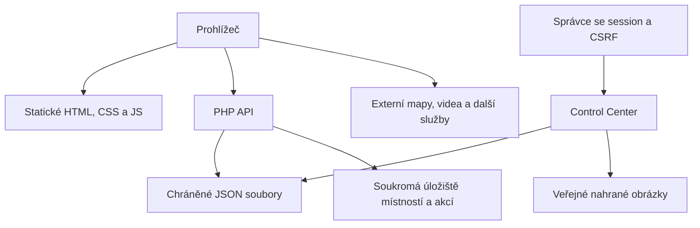

# Architektura a data

## Základní uspořádání

Hlavní web je sada statických HTML stránek doplněná PHP endpointy. Nevyžaduje databázi, Composer, Node ani kompilaci před nasazením. JavaScript běží přímo v prohlížeči. GitHub Actions slouží ke kontrole zdrojů; neprovádí produkční nasazení.

## Moduly a odpovědnosti

| Modul | Zdroj | Úloha |
|---|---|---|
| Veřejný obsah | `www/`, rubriky a články | Stránky, fotografie, rozcestníky |
| Společný vzhled | `www/css/site.css`, `www/js/site.js` | Navigace, patička, mobilní menu a společné barvy |
| Dynamické záznamy | `www/record.php`, `www/api/` | Zobrazení publikovaného obsahu a veřejná data |
| Administrace | `www/admin/` | Přihlášení, obsah, média, analytika, vzhled |
| Učebna | `www/nastroje/` | Nástroje v prohlížeči a sdílené místnosti |
| Halloween | `www/halloween/` | Fronta, role, vstupenky a obsazenost |
| Mapa podniků | `www/hospody/` | Prohlížení uloženého výřezu OSM |
| Výuka | `subdoms/zs-sokolov/` | Fyzika, informatika a výtvarná výchova |

## Konfigurace a oddělení dat

| Umístění | Obsah | Patří do Gitu? |
|---|---|---|
| `config-examples/records.public.json` | Výchozí vzorek již zveřejněných záznamů | Ano |
| `www/admin/data/config.php` | Místní účet, hash hesla a tajný klíč | Ne |
| `www/admin/data/*.json` | Živé záznamy, vzhled, analytika a provozní přehledy | Ne |
| `www/uploads/` | Veřejně dostupné obrázky nahrané správcem | Jen ochranné soubory; skutečná média ne |
| `.altivox-nastroje/` mimo document root | Místnosti, klíče a sdílené soubory | Ne |
| `.altivox-halloween/` mimo document root | Akce, role, fronta a historie operací | Ne |

Umístění soukromých místností lze změnit proměnnými prostředí `ALTIVOX_TOOLS_DATA` a `ALTIVOX_HALLOWEEN_DATA`. Cílové adresáře musí být zapisovatelné účtem PHP a mimo veřejně obsluhované adresáře. Ve výchozím rozložení se vytvářejí vedle `www`.

## Zápisy a souběh

Administrace zapisuje JSON přes dočasný soubor a přejmenování. To omezuje poškození jednotlivého zápisu, ale samo nezajišťuje transakci celého cyklu načtení–úprava–uložení: souběžné úpravy mohou přepsat novější stav. Stejné omezení se týká souběžných aktualizací jednoduché analytiky.

Třídní místnosti používají zámek souboru při práci se stavem. Halloween odděluje jádro pravidel v `core.php` od transportu v `api.php`, zamyká akce a ukládá stav atomicky. Identifikátory požadavků brání opakovanému provedení stejné operace po síťové nejistotě.

## Sdílení vzhledu a závislosti

Veřejné stránky načítají společné CSS a dynamické `/api/theme.php`. Výuková subdoména načítá společné prostředky z hlavního webu. Její dostupnost proto závisí také na hlavní doméně. Barevné schéma neobarvuje fotografie ani všechny významové barvy grafů.

Část aplikací používá externí služby: YouTube, mapové podklady, Leaflet z CDN, meteorologické a kamerové zdroje. Přesné adresy jsou součástí konkrétních stránek a mohou se měnit nezávisle na ALTIVOXu. Dostupnost těchto služeb nelze zajistit samotným nakopírováním repozitáře.
